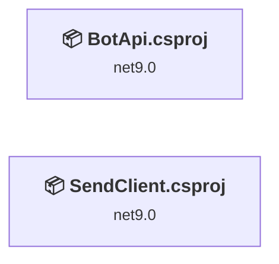
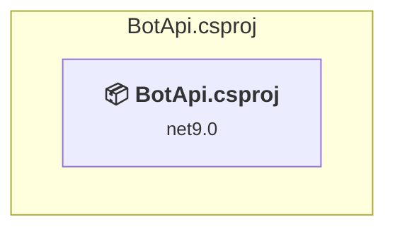
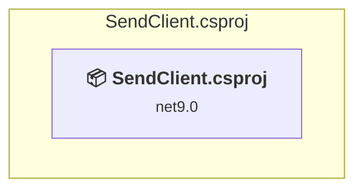

# Projects and dependencies analysis

This document provides a comprehensive overview of the projects and their dependencies in the context of upgrading to .NETCoreApp,Version=v10.0.

## Table of Contents

- [Executive Summary](#executive-Summary)
  - [Highlevel Metrics](#highlevel-metrics)
  - [Projects Compatibility](#projects-compatibility)
  - [Package Compatibility](#package-compatibility)
  - [API Compatibility](#api-compatibility)
  - [Binding Redirect Configuration](#binding-redirect-configuration)
- [Aggregate NuGet packages details](#aggregate-nuget-packages-details)
- [Top API Migration Challenges](#top-api-migration-challenges)
  - [Technologies and Features](#technologies-and-features)
  - [Most Frequent API Issues](#most-frequent-api-issues)
- [Projects Relationship Graph](#projects-relationship-graph)
- [Project Details](#project-details)

  - [BotApi\BotApi.csproj](#botapibotapicsproj)
  - [SendClient\SendClient.csproj](#sendclientsendclientcsproj)

## Executive Summary

### Highlevel Metrics

| Metric | Count | Status |
| :--- | :---: | :--- |
| Total Projects | 2 | All require upgrade |
| Total NuGet Packages | 21 | 3 need upgrade |
| Total Code Files | 15 |  |
| Total Code Files with Incidents | 11 |  |
| Total Lines of Code | 1460 |  |
| Total Number of Issues | 61 |  |
| Estimated LOC to modify | 56+ | at least 3,8% of codebase |

### Projects Compatibility

| Project | Target Framework | Difficulty | Package Issues | API Issues | Binding Issues | Est. LOC Impact | Description |
| :--- | :---: | :---: | :---: | :---: | :---: | :---: | :--- |
| [BotApi\BotApi.csproj](#botapibotapicsproj) | net9.0 | 🟢 Low | 2 | 22 | 0 | 22+ | AspNetCore, Sdk Style = True |
| [SendClient\SendClient.csproj](#sendclientsendclientcsproj) | net9.0 | 🟢 Low | 1 | 34 | 0 | 34+ | AspNetCore, Sdk Style = True |

### Package Compatibility

| Status | Count | Percentage |
| :--- | :---: | :---: |
| ✅ Compatible | 18 | 85,7% |
| ⚠️ Incompatible | 1 | 4,8% |
| 🔄 Upgrade Recommended | 2 | 9,5% |
| ***Total NuGet Packages*** | ***21*** | ***100%*** |

### API Compatibility

| Category | Count | Impact |
| :--- | :---: | :--- |
| 🔴 Binary Incompatible | 0 | High - Require code changes |
| 🟡 Source Incompatible | 26 | Medium - Needs re-compilation and potential conflicting API error fixing |
| 🔵 Behavioral change | 30 | Low - Behavioral changes that may require testing at runtime |
| ✅ Compatible | 2684 |  |
| ***Total APIs Analyzed*** | ***2740*** |  |

## Aggregate NuGet packages details

| Package | Current Version | Suggested Version | Projects | Description |
| :--- | :---: | :---: | :--- | :--- |
| Microsoft.AspNetCore.Authentication.OpenIdConnect | 9.0.10 | 10.0.12 | [SendClient.csproj](#sendclientsendclientcsproj) | Ein NuGet-Paketupgrade wird empfohlen |
| Microsoft.AspNetCore.OpenApi | 9.0.10 | 10.0.12 | [BotApi.csproj](#botapibotapicsproj) | Ein NuGet-Paketupgrade wird empfohlen |
| Microsoft.Bcl.Cryptography | 10.0.2 |  | [SendClient.csproj](#sendclientsendclientcsproj) | ✅Compatible |
| Microsoft.Extensions.ApiDescription.Server | 9.0.0 |  | [BotApi.csproj](#botapibotapicsproj) | ✅Compatible |
| Microsoft.Extensions.DependencyInjection.Abstractions | 8.0.0 |  | [SendClient.csproj](#sendclientsendclientcsproj) | ✅Compatible |
| Microsoft.Extensions.Logging.Abstractions | 8.0.0 |  | [SendClient.csproj](#sendclientsendclientcsproj) | ✅Compatible |
| Microsoft.IdentityModel.Abstractions | 8.19.2 |  | [SendClient.csproj](#sendclientsendclientcsproj) | ✅Compatible |
| Microsoft.IdentityModel.JsonWebTokens | 8.19.2 |  | [SendClient.csproj](#sendclientsendclientcsproj) | ✅Compatible |
| Microsoft.IdentityModel.Logging | 8.19.2 |  | [SendClient.csproj](#sendclientsendclientcsproj) | ✅Compatible |
| Microsoft.IdentityModel.Protocols | 8.19.2 |  | [SendClient.csproj](#sendclientsendclientcsproj) | ✅Compatible |
| Microsoft.IdentityModel.Protocols.OpenIdConnect | 8.19.2 |  | [SendClient.csproj](#sendclientsendclientcsproj) | ✅Compatible |
| Microsoft.IdentityModel.Tokens | 8.19.2 |  | [SendClient.csproj](#sendclientsendclientcsproj) | ✅Compatible |
| Microsoft.OpenApi | 2.7.5 |  | [BotApi.csproj](#botapibotapicsproj) | ✅Compatible |
| Microsoft.VisualStudio.Azure.Containers.Tools.Targets | 1.23.0 |  | [BotApi.csproj](#botapibotapicsproj) | ⚠️Das NuGet-Paket ist nicht kompatibel |
| Newtonsoft.Json | 13.0.4 |  | [BotApi.csproj](#botapibotapicsproj) | ✅Compatible |
| Swashbuckle.AspNetCore | 10.2.3 |  | [BotApi.csproj](#botapibotapicsproj) | ✅Compatible |
| Swashbuckle.AspNetCore.Swagger | 10.2.3 |  | [BotApi.csproj](#botapibotapicsproj) | ✅Compatible |
| Swashbuckle.AspNetCore.SwaggerGen | 10.2.3 |  | [BotApi.csproj](#botapibotapicsproj) | ✅Compatible |
| Swashbuckle.AspNetCore.SwaggerUI | 10.2.3 |  | [BotApi.csproj](#botapibotapicsproj) | ✅Compatible |
| System.IdentityModel.Tokens.Jwt | 8.19.2 |  | [SendClient.csproj](#sendclientsendclientcsproj) | ✅Compatible |
| System.Text.Json | 8.0.5 |  | [BotApi.csproj](#botapibotapicsproj) | ✅Compatible |

## Top API Migration Challenges

### Technologies and Features

| Technology | Issues | Percentage | Migration Path |
| :--- | :---: | :---: | :--- |

### Most Frequent API Issues

| API | Count | Percentage | Category |
| :--- | :---: | :---: | :--- |
| T:System.Net.Http.HttpContent | 11 | 19,6% | Behavioral Change |
| T:System.Uri | 9 | 16,1% | Behavioral Change |
| P:Microsoft.AspNetCore.Authentication.OpenIdConnect.OpenIdConnectOptions.Scope | 5 | 8,9% | Source Incompatible |
| M:System.Uri.#ctor(System.String) | 3 | 5,4% | Behavioral Change |
| T:Microsoft.AspNetCore.Authentication.OpenIdConnect.OpenIdConnectDefaults | 3 | 5,4% | Source Incompatible |
| F:Microsoft.AspNetCore.Authentication.OpenIdConnect.OpenIdConnectDefaults.AuthenticationScheme | 3 | 5,4% | Source Incompatible |
| M:Microsoft.Extensions.DependencyInjection.HttpClientFactoryServiceCollectionExtensions.AddHttpClient(Microsoft.Extensions.DependencyInjection.IServiceCollection,System.String,System.Action{System.Net.Http.HttpClient}) | 2 | 3,6% | Behavioral Change |
| M:Microsoft.Extensions.DependencyInjection.HttpClientFactoryServiceCollectionExtensions.AddHttpClient(Microsoft.Extensions.DependencyInjection.IServiceCollection) | 2 | 3,6% | Behavioral Change |
| T:Microsoft.AspNetCore.Authentication.OpenIdConnect.OpenIdConnectEvents | 2 | 3,6% | Source Incompatible |
| P:Microsoft.AspNetCore.Authentication.OpenIdConnect.OpenIdConnectOptions.NonceCookie | 2 | 3,6% | Source Incompatible |
| M:System.Uri.#ctor(System.Uri,System.String) | 1 | 1,8% | Behavioral Change |
| M:Microsoft.AspNetCore.Builder.ExceptionHandlerExtensions.UseExceptionHandler(Microsoft.AspNetCore.Builder.IApplicationBuilder,System.String) | 1 | 1,8% | Behavioral Change |
| M:Microsoft.AspNetCore.Builder.ForwardedHeadersExtensions.UseForwardedHeaders(Microsoft.AspNetCore.Builder.IApplicationBuilder) | 1 | 1,8% | Behavioral Change |
| P:Microsoft.AspNetCore.Authentication.OpenIdConnect.OpenIdConnectEvents.OnTokenValidated | 1 | 1,8% | Source Incompatible |
| M:Microsoft.AspNetCore.Authentication.OpenIdConnect.OpenIdConnectEvents.#ctor | 1 | 1,8% | Source Incompatible |
| P:Microsoft.AspNetCore.Authentication.OpenIdConnect.OpenIdConnectOptions.Events | 1 | 1,8% | Source Incompatible |
| P:Microsoft.AspNetCore.Authentication.OpenIdConnect.OpenIdConnectOptions.TokenValidationParameters | 1 | 1,8% | Source Incompatible |
| P:Microsoft.AspNetCore.Authentication.OpenIdConnect.OpenIdConnectOptions.ResponseType | 1 | 1,8% | Source Incompatible |
| P:Microsoft.AspNetCore.Authentication.OpenIdConnect.OpenIdConnectOptions.ClientSecret | 1 | 1,8% | Source Incompatible |
| P:Microsoft.AspNetCore.Authentication.OpenIdConnect.OpenIdConnectOptions.ClientId | 1 | 1,8% | Source Incompatible |
| P:Microsoft.AspNetCore.Authentication.OpenIdConnect.OpenIdConnectOptions.Authority | 1 | 1,8% | Source Incompatible |
| T:Microsoft.Extensions.DependencyInjection.OpenIdConnectExtensions | 1 | 1,8% | Source Incompatible |
| M:Microsoft.Extensions.DependencyInjection.OpenIdConnectExtensions.AddOpenIdConnect(Microsoft.AspNetCore.Authentication.AuthenticationBuilder,System.Action{Microsoft.AspNetCore.Authentication.OpenIdConnect.OpenIdConnectOptions}) | 1 | 1,8% | Source Incompatible |
| P:Microsoft.AspNetCore.Builder.ForwardedHeadersOptions.KnownNetworks | 1 | 1,8% | Source Incompatible |

## Projects Relationship Graph

Legend:
📦 SDK-style project
⚙️ Classic project

## Project Details

### BotApi\BotApi.csproj

#### Project Info

- **Current Target Framework:** net9.0
- **Proposed Target Framework:** net10.0
- **SDK-style**: True
- **Project Kind:** AspNetCore
- **Dependencies**: 0
- **Dependants**: 0
- **Number of Files**: 16
- **Number of Files with Incidents**: 8
- **Lines of Code**: 1304
- **Estimated LOC to modify**: 22+ (at least 1,7% of the project)

#### Dependency Graph

Legend:
📦 SDK-style project
⚙️ Classic project

### API Compatibility

| Category | Count | Impact |
| :--- | :---: | :--- |
| 🔴 Binary Incompatible | 0 | High - Require code changes |
| 🟡 Source Incompatible | 0 | Medium - Needs re-compilation and potential conflicting API error fixing |
| 🔵 Behavioral change | 22 | Low - Behavioral changes that may require testing at runtime |
| ✅ Compatible | 1797 |  |
| ***Total APIs Analyzed*** | ***1819*** |  |

### SendClient\SendClient.csproj

#### Project Info

- **Current Target Framework:** net9.0
- **Proposed Target Framework:** net10.0
- **SDK-style**: True
- **Project Kind:** AspNetCore
- **Dependencies**: 0
- **Dependants**: 0
- **Number of Files**: 15
- **Number of Files with Incidents**: 3
- **Lines of Code**: 156
- **Estimated LOC to modify**: 34+ (at least 21,8% of the project)

#### Dependency Graph

Legend:
📦 SDK-style project
⚙️ Classic project

### API Compatibility

| Category | Count | Impact |
| :--- | :---: | :--- |
| 🔴 Binary Incompatible | 0 | High - Require code changes |
| 🟡 Source Incompatible | 26 | Medium - Needs re-compilation and potential conflicting API error fixing |
| 🔵 Behavioral change | 8 | Low - Behavioral changes that may require testing at runtime |
| ✅ Compatible | 887 |  |
| ***Total APIs Analyzed*** | ***921*** |  |

